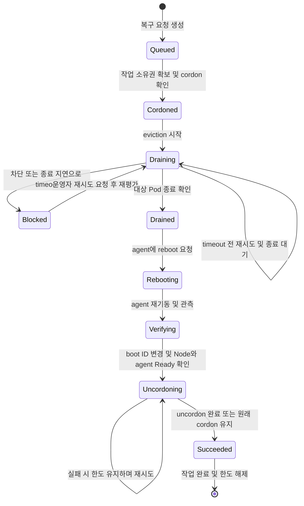

# NodeRepair와 DrainPolicy 구현 가이드

NodeInventory와 NodeRepair의 구현 및 검증 기준이다. NodeInventory와 NodeRepair의 읽기 전용 CordonDrain 미리보기는 구현되어 있다. 실제 cordon, drain, reboot, DrainPolicy와 노드 agent는 아직 구현되지 않았다. 아래 정책은 목표 동작이며 API와 구체적인 상태 이름은 구현 과정에서 확정한다.

# 범위와 원칙

- NodeInventory는 승인된 기준과 노드 관측을 관리한다. Kubernetes Node lifecycle condition은 현재 버전에 추가하지 않는다.

- NodeRepair는 노드 UID에 연결된 개별 작업과 이력을 표현한다. 완료된 작업은 종료 시각으로부터 30일 후 자동 삭제한다. 추후 exporter로 metric을 외부에 제공하고 별도 저장을 검토한다. metric은 개별 작업 이력의 보존을 보장하지 않는다.

- DrainPolicy는 cluster-scoped이며 ignoreDaemonSets, deleteEmptyDirData, timeout, gracePeriod를 설정한다. 기본값은 각각 true, true, 30분, 300초다. 배포 시 이름이 `default`인 기본 DrainPolicy를 함께 설치한다. NodeRepair는 정책 이름을 지정하며 미지정 시 기본 정책을 사용한다. 정책이 없거나 읽을 수 없으면 실제 작업을 보류하고 원인을 표시한다. 작업 시작 시 정책을 저장해 해당 작업에 유지하며, 새 정책을 적용하려면 새 NodeRepair를 생성한다. 기존 작업의 소유권과 한도 처리를 먼저 확인해야 한다. controller가 관리하지 않는 단독 Pod도 기본 eviction 대상이다. emptyDir 데이터는 Pod가 노드를 떠날 때 삭제될 수 있고 단독 Pod는 종료 후 자동으로 재생성되지 않을 수 있다. 초기 rollout은 수동이며 추후 허용된 Deployment 목록을 정책으로 관리한다.

- 초기 실제 NodeRepair는 cordon, drain과 reboot을 포함한다. dryRun=true는 관측만 수행하고 false는 실제 작업을 요청한다. 현재 구현은 CordonDrain dry-run만 지원한다.

- 초기 구현은 관측과 dry-run을 기본으로 한다. PDB 우회, Pod 강제 삭제와 강제 reboot은 자동 실행하지 않는다.

- 운영자가 NodeInventory의 spec에서 maintenance를 선언하면 실제 cordon·drain·reboot을 요청하는 NodeRepair를 생성한다. 선언 ID당 한 번만 생성하고 재선언 시 새 ID를 사용한다. 해당 선언이 생성한 작업만 그 maintenance가 활성인 동안 실행할 수 있다. 다른 자동 복구 요청은 대기시키고 종료 후 재평가한다. maintenance 선언은 운영자가 직접 해제한다. 진행 중 해제하면 cordon을 유지하고 drain 중인 작업은 drain을 마무리하며, reboot 시작 전에는 reboot을 취소한다. reboot이 시작된 후에는 취소할 수 없다.

- NVSentinel은 GPU 장애 감지 및 설정된 격리를 담당한다. 같은 노드에서 NVSentinel, kured와 자체 실행기가 중복 복구하지 않도록 실행 주체를 분리한다.

# 공통 작업 흐름

1. NodeRepair 생성 시 노드 이름과 UID, 작업 유형, 출처, 원인을 기록한다.

2. 최신 Node와 inventory, 정책 및 활성 작업을 확인하고 원자적으로 작업 소유권을 확보한다. NodeInventory가 없거나 오래되었거나 Node UID가 일치하지 않으면 실제 작업을 보류하고 원인을 표시한다. 최대 관측 age는 기본 5분이며 설정으로 변경할 수 있다. 미래 시각과 누락된 관측 시각도 보류한다.

3. 기존 cordon 상태를 기록하고 노드를 cordon한다.

4. Kubernetes Eviction API를 사용해 PDB를 존중하며 대상 Pod를 내보내고 종료를 확인한다.

5. 대상 Pod가 모두 종료되면 Drained를 기록한다. DaemonSet 및 mirror Pod 등 제외 대상을 정책과 결과에 명시한다.

6. 대상 Pod 종료 후 agent가 reboot을 수행한다. boot ID 변경, Node Ready=True와 해당 노드 agent Pod Ready=True를 확인한다. 이 작업이 cordon한 노드는 자동 uncordon하고 원래 cordon된 노드는 유지한다. 필요한 uncordon이 성공하면 작업을 완료하고 한도를 해제한다. uncordon 실패 시 완료와 한도 해제를 보류하고 재시도한다.

제안 상태: Pending, Queued, Cordoning, Draining, Blocked, Drained 및 Reboot 작업의 복구 검증 상태. 실제 CRD 타입과 상태 전이는 구현 전 확정한다.

## NodeRepair 상태 흐름

아래는 제안된 단일 노드 복구 작업 흐름이다. Queued부터 NodeRepair의 작업 상태이며 운영자 조치는 외부 행위다. 실제 상태 이름과 timeout은 구현 전 확정한다.

`Blocked`는 재개 가능한 상태다. drain timeout에 도달하면 운영자가 명시적으로 재시도할 때까지 대기한다. PDB 차단, Pod 종료 지연과 API 오류는 근거에 따라 reason으로 구분한다. 운영자의 rollout이나 수동 조치만으로 `Drained`가 되지 않으며, 재평가에서 정책상 제외한 Pod를 뺀 대상 Pod의 종료가 확인되어야 한다. 강제 삭제로 API에서 사라진 것만으로 실제 프로세스 종료를 확정하지 않는다.

`Drained`는 복구의 중간 단계다. reboot과 복귀 검증이 끝나기 전까지 동시 작업 한도를 유지한다. 실패·취소·차단 시 cordon과 한도를 유지하며, 운영자가 한도 해제와 uncordon을 각각 명시적으로 수행한다.

# 유즈케이스

## 단일 노드 cordon과 drain

NodeRepair 생성 → Node UID 및 기존 작업 확인 → 기존 cordon 상태 저장 → cordon → eviction → 대상 Pod 종료 확인 → agent reboot → boot ID 변경, Node Ready 및 해당 노드 agent Pod Ready 확인. 원래 cordon된 노드는 임의로 uncordon하지 않는다.

## 여러 노드

노드마다 NodeRepair를 생성해 이력을 분리한다. 클러스터 전체 기본 동시 작업 한도는 1이며 설정으로 변경할 수 있다. drain된 노드도 reboot 및 복귀 검증과 필요한 uncordon이 완료될 때까지 한도를 점유한다. 실패·취소·차단 시 한도를 유지하며 운영자가 명시적으로 해제한다. 모든 eviction에서 PDB를 존중한다.

## PDB로 eviction이 거부됨

cordon → eviction 요청 → 거부 응답 및 PDB 상태 확인 → timeout 전 재시도 → timeout 시 Blocked와 근거 기록. replica 1 Deployment의 현재 운영 절차는 운영자가 rollout을 실행하고, 대체 Pod가 다른 노드에서 Ready가 되는지 확인하는 것이다. timeout 후에는 운영자가 명시적으로 재시도를 요청하고 남은 drain을 재평가한다. 실제 eviction 응답과 PDB 상태로 확인되지 않으면 PDB를 확정 원인으로 표시하지 않는다. PDB 변경이나 직접 삭제로 우회하지 않는다.

## Pod가 계속 Terminating

eviction이 수락된 후 Pod 종료를 기다린다. timeout 시 Pod UID, deletionTimestamp, grace period, finalizer와 Node Ready 상태를 기록하고 PodTerminationDelayed로 운영자에게 알린다. 종료가 확인되면 다시 진행한다. 기다림을 생략하거나 강제 삭제하는 것은 실제 프로세스 종료의 증거가 아니므로 기본적으로 하지 않는다.

## 대체 Pod가 Pending 또는 NotReady

rollout 후 다른 노드에서 Ready가 되는 것을 기다린다. GPU 용량, affinity 또는 scheduling 문제로 진행되지 않으면 WaitingForReplacement와 원인을 표시하고 drain 완료나 reboot으로 진행하지 않는다. rollout 전략과 가용 자원을 별도로 검토한다.

## 중복 요청과 다중 실행기

같은 Node UID의 활성 복구 작업은 하나만 허용하는 방향을 제안한다. 단순 조회만으로 동시 생성을 막을 수 없으므로 원자적 소유권 획득 및 경쟁 처리 방식을 구현한다. kured lock은 별도 실행기를 보호하지 않는다. 같은 sentinel이나 노드를 kured와 자체 실행기가 동시에 처리하지 않도록 전환 계획이 필요하다.

## controller 재시작과 API 장애

작업 ID와 관측 가능한 단계 결과를 기록한다. 재시작 후 실제 Node UID, cordon 상태, Pod 및 rollout 상태를 다시 읽어 진행한다. API를 읽지 못하면 완료로 판단하지 않는다. 재시작으로 rollout이나 reboot을 중복 실행하지 않도록 실행 ID와 재확인 절차가 필요하다. 정책을 바꾸기 위해 새 NodeRepair를 만들 때도 기존 작업의 cordon과 한도는 자동 해제하지 않는다.

## 노드 삭제, UID 교체 및 접근 불가

Node가 삭제되거나 같은 이름의 다른 UID로 재생성되면 기존 작업을 중단하고 새 노드에 적용하지 않는다. NotReady 또는 접근 불가 상태에서는 Pod 종료와 실제 reboot 결과를 추론하지 않고 운영자 확인을 요청한다.

## 취소 및 reboot

일반 취소는 새 eviction과 reboot 요청을 중단하며, 이미 수락된 eviction은 되돌릴 수 없다. maintenance 해제 시 drain이 진행 중이면 drain을 마무리하고 reboot 시작 전에는 reboot을 취소한다. reboot 진행 중에는 취소할 수 없다. reboot 취소 또는 drain 미완료를 포함해 실패·취소·차단 시 cordon과 동시 작업 한도를 유지하며, 운영자가 한도 해제와 uncordon을 각각 명시적으로 수행한다. reboot 후 boot ID 변경, Node Ready=True 및 해당 노드 agent Pod Ready=True를 확인한다.

# sentinel과 실행기

노드 agent가 기존 sentinel을 감지해 NodeRepair 생성을 확인한 뒤 sentinel을 삭제한다. API 장애 또는 생성 결과가 불확실할 때는 삭제하지 않고 중복 방지 방식으로 확인·재시도해야 한다. 파일 생성과 API 변경은 원자적이지 않으므로 새로운 신호의 손실을 막는 프로토콜이 필요하다. 동일 sentinel을 kured와 동시에 처리하지 않도록 노드별 전환과 소유권을 정한다. 구체적인 식별 및 동시 파일 변경 처리 방법은 미결정이다.

# 단계별 구현과 검증

1. NodeRepair API와 단일 노드 관측 및 dry-run. 예상 대상과 차단 요인을 표시한다.

2. 단일 노드 cordon 및 PDB 존중 drain. 실패, 취소와 재시작 복구를 검증한다.

3. 다중 노드 큐, 동시성·가용성 예산, 중복 요청과 소유권 충돌을 검증한다.

4. DrainPolicy 기반 진단과 운영자 수동 rollout 연계를 추가한다.

5. 명시적으로 허용한 Deployment의 자동 rollout을 별도 단계로 검토한다.

6. 노드 agent와 reboot, boot ID 및 Ready 확인을 테스트 노드에서 검증한다.

# 구현 전 결정할 사항

- NodeRepair와 DrainPolicy의 정확한 API, 상태 소유자, condition 및 종료 시각 정의.

- maintenance 선언 ID의 생성과 중복 생성 방지, 해제와 reboot 시작이 경합할 때의 원자적 처리 및 실행 상태 불확실성 처리.

- 자동 uncordon 재시도의 간격·timeout과 복구 실패 시 운영자 조치의 구체적 API.

- 동시 작업 한도의 원자적 구현, 장애 복구 및 운영자의 명시적 해제 권한.

- 정책 snapshot의 저장 구조와 향후 workload별 예외 적용 범위.

- rollout 자동화 opt-in, 동시성, 중복 방지, 실패 및 배치 검증 정책.

- 기존 sentinel 생산자의 변경 가능 여부를 확인한 후 소유권, 중복 생성 방지 및 새 신호와 삭제의 경합 처리, agent 권한과 kured 전환 방식을 결정한다.

- NVSentinel의 실제 condition, 격리 및 remediation 설정과 작업 출처.

- 알림 채널과 장애별 관측 근거.

# 참고

- [Kubernetes drain](https://kubernetes.io/docs/reference/kubectl/generated/kubectl_drain/)

- [Kubernetes eviction](https://kubernetes.io/docs/concepts/scheduling-eviction/api-eviction/)

- [Kubernetes Pod disruption](https://kubernetes.io/docs/concepts/workloads/pods/disruptions/)

- [kured 구현](https://github.com/kubereboot/kured/blob/main/cmd/kured/main.go)

- [NVSentinel](https://github.com/NVIDIA/NVSentinel)
